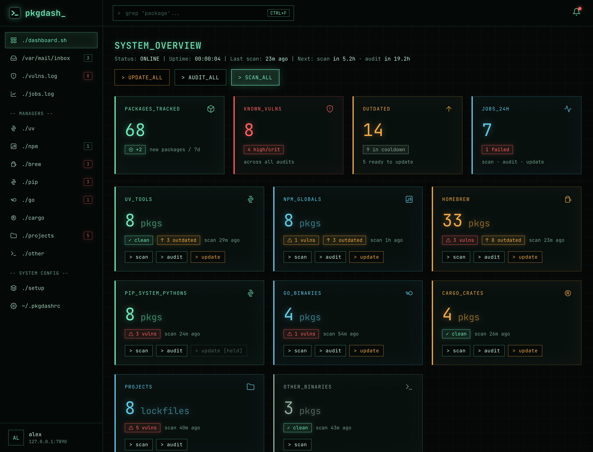
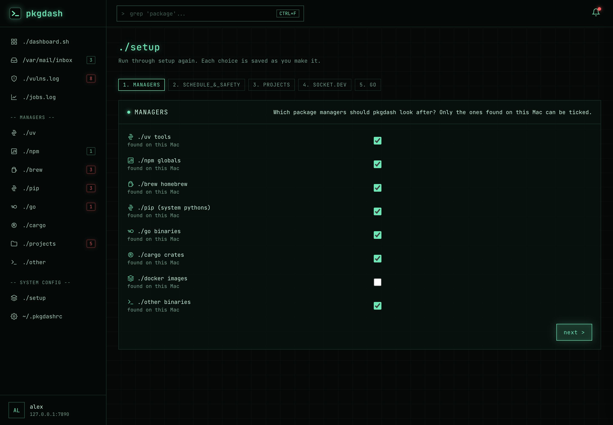
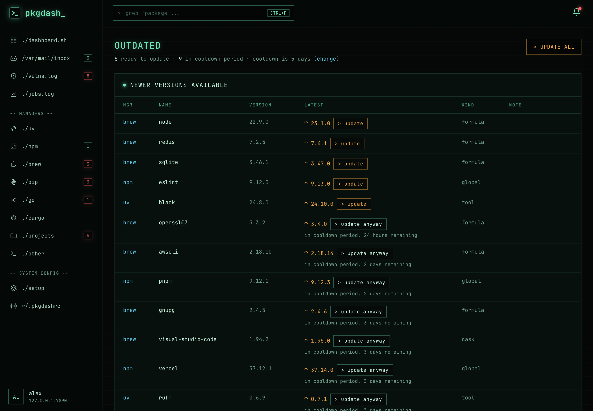
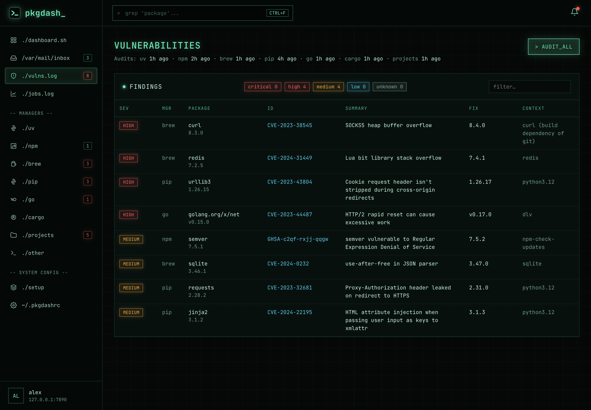
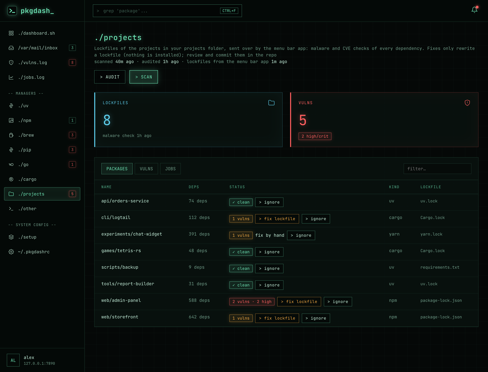
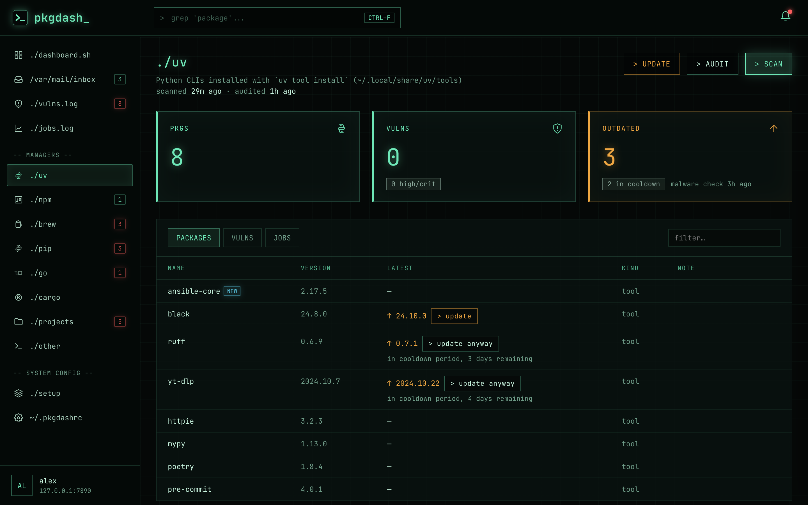
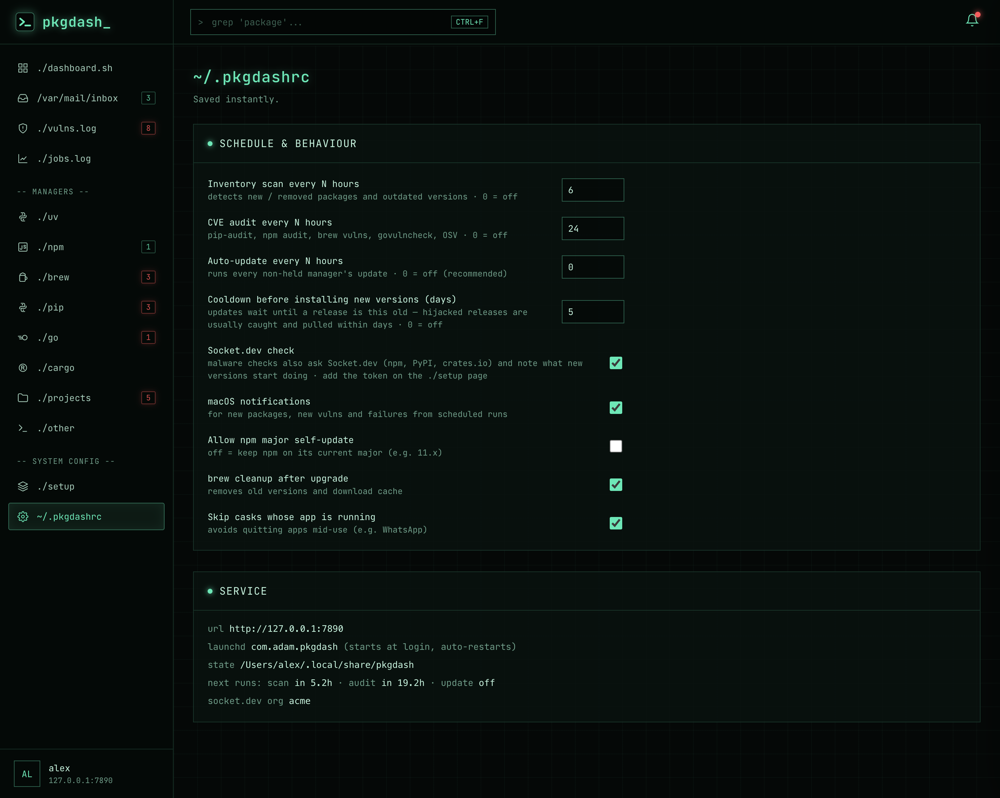

<div align="center">

# `>_ pkgdash_`

**One dashboard for every package manager on your Mac**: inventory, CVE audits, malware checks and
updates for uv, npm, Homebrew, pip, Go, Cargo, Docker images, and the lockfiles of your own projects.

[](https://github.com/adamtty/pkgdash/actions/workflows/ci.yml)
[](https://github.com/adamtty/pkgdash/actions/workflows/codeql.yml)
[](https://scorecard.dev/viewer/?uri=github.com/adamtty/pkgdash)


[](LICENSE)



<sub>Screenshots use the built-in demo data (<code>demo.py</code>), not a real machine.</sub>

</div>

## What it does

| | |
|---|---|
| 📦 **One place for everything installed** | uv tools, npm globals, Homebrew formulae and casks, pip, Go binaries, Cargo crates, Docker images and stray binaries. It also spots managers it doesn't track yet (pipx, pnpm, yarn, bun, mas, conda). |
| 🆕 **New and removed package detection** | Every scan is compared with the last one. New installs get a NEW tag for a week, and anything added or removed lands in the inbox. |
| ⬆️ **Updates** | Update everything, one manager, or one package. Casks whose app is running are skipped, npm stays on its major version, and locally built tools are left alone. |
| 🛡️ **CVE audits** | pip-audit, npm audit, brew vulns, govulncheck and OSV, merged into one list you can filter by severity, with fixed versions. |
| ⏳ **Cooldown period** | New releases wait a few days before being installed, because hijacked releases are usually pulled within days. "in cooldown period, 3 days remaining", with an `update anyway` button. |
| ☠️ **Malware checks** | Everything installed, dependencies included, is checked against OSV's malicious-packages list on every scan, and again just before an update. Known-bad versions can't be installed. |
| 🔌 **Socket.dev** (optional) | Socket's verdicts block bad versions too, and each pending update is labelled with what it newly does (install scripts, network access, a maintainer change…). |
| 📁 **Projects** | The lockfiles of every project in a folder you choose are checked for malware and CVEs. One click rewrites a lockfile to fixed versions **without installing anything**. |
| 🐳 **Docker images** | Package lists are read from `docker save` output (no container is ever started) and checked for malware and CVEs, including Debian, Ubuntu and Alpine packages. |
| 🔔 **Schedules and notifications** | Scans every 6 h and audits daily, with optional auto-update. macOS notifications for new packages, vulns, malware and failures. |
| 📟 **Live job output** | Progress bars with time estimates from previous runs. Click a running job to watch its terminal output. |
| 🧭 **Menu bar icon** | High/critical count at a glance, spins while jobs run, right-click for quick actions. |

## Screenshots

<table>
<tr>
<td width="50%"><b>Setup</b>: a wizard on first run, a page afterwards<br></td>
<td width="50%"><b>Outdated packages</b>: cooldown periods, per-package updates<br></td>
</tr>
<tr>
<td><b>Vulnerabilities</b>: every audit in one list, filterable by severity<br></td>
<td><b>Projects</b>: your projects' lockfiles, fix / ignore per project<br></td>
</tr>
<tr>
<td><b>A manager's page</b>: packages, vulns and job history for uv<br></td>
<td><b>Settings</b>: schedules, cooldown, Socket check, service status<br></td>
</tr>
</table>

## Install

Needs macOS 13+ on Apple Silicon and the Xcode Command Line Tools (`xcode-select --install`), which
provide `/usr/bin/python3` and `swiftc`. Nothing else: the service is standard-library Python.

```sh
git clone https://github.com/adamtty/pkgdash.git
cd pkgdash
./install.sh            # install, or restart after any edit
./install.sh uninstall  # remove (state in ~/.local/share/pkgdash is kept)
```

Then open **http://127.0.0.1:7878**. The first visit opens the **setup wizard**:

1. **Managers**: pkgdash detects which package managers are installed; untick any you don't want tracked.
2. **Schedule & safety**: scan and audit intervals, auto-update (off by default), the cooldown period and notifications.
3. **Projects**: whether to check your projects' lockfiles, and which folder they're in (`~/Documents`, `~/Developer`, `~/code`…).
4. **Socket.dev** (optional): paste an API token, which is tested and stored in your login Keychain.

Nothing runs until setup is done. Afterwards everything stays editable on the **./setup** page, which can
also run the wizard again.

`install.sh` copies the service to `~/.local/share/pkgdash/app`, because launchd agents can't read protected
folders like `~/Documents`. It builds the menu bar app into `~/Applications/pkgdash.app` and loads the
LaunchAgents `com.adam.pkgdash` and `com.adam.pkgdash.menu`. **Re-run it after any edit.** State, job logs
and `service.log` live in `~/.local/share/pkgdash`.

### Try it without installing

```sh
/usr/bin/python3 -I demo.py     # → http://127.0.0.1:7890
```

The real dashboard with made-up packages, findings and projects. Nothing is scanned, installed or sent
anywhere, and its state lives in a temporary folder that's deleted when you stop it. It's also how the
screenshots are made.

| File | What it is |
|---|---|
| `server.py` | The service: standard-library Python run by `/usr/bin/python3 -I` |
| `index.html` | The dashboard, including the setup wizard (a single page, no build step) |
| `menubar/PkgdashMenu.swift` | Menu bar icon, plus the reader for project lockfiles |
| `install.sh` | Install / restart / uninstall |
| `demo.py` | The demo above |

## How it works

### Package managers

| Manager | Scan | Audit | Update |
|---|---|---|---|
| uv | `uv tool list [--outdated]` + receipt pins/sources | `pip-audit` per tool env | `uv tool upgrade <tool>` one by one (skips tools installed from protected folders) |
| npm | `npm ls/outdated -g` | `npm audit` on a scratch copy of each global | reinstall all globals `@latest` (npm kept on its major unless enabled) |
| brew | `brew update` + list/outdated | `brew vulns` (OSV) | upgrade formulae + casks (skips running apps), cleanup |
| pip | Homebrew Pythons + `--user` installs in macOS python; flags strays | `pip-audit` | disabled by design (use uv) |
| go | `go version -m` + `go list -m @latest` | `govulncheck -mode=binary` | `go install <pkg>@latest` (rebuilds with current Go) |
| cargo | `cargo install --list` + crates.io | OSV (top-level crate only) | `cargo install --locked` |
| docker | `docker save` per image (cached by image id; nothing runs) | OSV, incl. Debian/Ubuntu/Alpine | — |
| other | ~/.local/bin, /usr/local/bin, extra managers | — | — |

Single packages: each outdated package has its own `> update` button (`brew upgrade --formula/--cask <name>`,
`uv tool upgrade <name>`, `npm i -g <name>@latest`, `go install …@latest`, `cargo install --locked <name>`),
followed by a re-scan. The server only accepts names its last scan found.

### Supply-chain guards

<details>
<summary><b>Cooldown</b> (<code>cooldown_days</code>, default 5)</summary>

Updates wait until a release is that old, since hijacked releases are usually caught and pulled within days.
uv uses `--exclude-newer` and npm `--before`, which also cover their dependencies; brew/go/cargo skip packages
still cooling (cargo is pinned to the scanned version). Release dates come from PyPI, the npm registry, the
Go proxy and crates.io; Homebrew has none, so its clock starts when a scan first sees the version.
</details>

<details>
<summary><b>Malware check</b> (OSV <code>MAL-</code> advisories)</summary>

Every scan asks OSV's malicious-packages list about everything installed, dependencies included (uv envs,
the full npm tree, Go module deps, cargo crates), and about each pending version; updates check again just
before installing. A flagged pending version is blocked even for "update anyway"; flagged installed packages
raise a red banner (click a line for the advisory), an inbox event and a notification. Homebrew isn't
covered (OSV has no Homebrew malware data).
</details>

<details>
<summary><b>Socket.dev</b> (<code>socket_check</code>; npm, PyPI, crates.io)</summary>

The malware check also asks Socket's API. Its blocking verdicts (malware, typosquats, protestware…) block
updates the same way, and each pending version gets a note: `socket ✓`, `not analysed yet`, or what it starts
doing that the installed version didn't (`new: install script · network access`). Add the token on the setup
page: it's tested against Socket, then stored in the login Keychain (item `pkgdash-socket-token`) through
`security -i` on stdin, so it never appears on a command line, and it's never written to pkgdash's own
files. Answers are cached in state.json (installed versions for 3 days, pending ones for a scan) because the
free plan's quota is small (500, 100 per lookup); the settings page shows what's left.
</details>

### Projects

The **projects** page checks the lockfiles of every project in the folder chosen on the setup page
(`package-lock.json`, `yarn.lock`, `uv.lock`, `poetry.lock`, `Cargo.lock`, pinned `requirements.txt`). It
must be inside your home folder. launchd agents can't read protected folders like `~/Documents`, so the
menu bar app (which macOS asks you to allow) finds the lockfiles, skipping `node_modules`/`.git`/venvs/
`target`, and sends new or changed ones to the service hourly or when a scan asks; copies live in
`~/.local/share/pkgdash/projects`.

- **Scan:** every dependency against OSV's malware list (Socket gets a couple of lookups per scan, changed projects first).
- **Audit:** every dependency's CVEs.
- **fix lockfile** (npm, uv, cargo): the menu bar app shows what it's about to run and asks first, then runs
  `npm audit fix --package-lock-only --ignore-scripts`, `uv lock --no-build --upgrade-package …` or
  `cargo update …`. These rewrite the lockfile only: nothing is installed and no package code runs. Review
  the result with `git diff` in the repo.
- **ignore:** for deliberate targets and other people's code. Their CVEs and malware stop counting.

Project counts stay out of the dashboard's headline totals. `install.sh` only rebuilds the menu bar app when
its source changes, since every rebuild makes macOS ask for folder access again.

## Security

pkgdash handles data it doesn't control (package names and versions, advisories, Docker images, other
people's projects) and drives tools that install software, so:

- **The service** binds to loopback only, rejects foreign `Host`/`Origin` headers (DNS-rebinding guard), and
  needs a per-process token for every POST, so web pages can't trigger anything. Only fixed actions run,
  never free-form commands, and package and project names must match the last scan.
- **Nothing runs on a schedule until setup is done**, and turned-off managers are never scanned or updated.
- **The menu bar app** holds macOS permission to read your projects folder, so it's the part kept tightest:
  - It asks before every lockfile fix, showing the project, the command and the exact binary. A fix
    requested through the service by some other program on your Mac still needs you to click.
  - It runs exactly three lockfile commands, by absolute path, with a fresh environment (nothing from the
    editable LaunchAgent, such as `NODE_OPTIONS`, reaches them). Settings that would let a project's own
    `.npmrc` or `.cargo/config.toml` pick a binary are pinned.
  - It never runs `git` in a project, since a cloned repo's own config (`core.fsmonitor`, `diff.external`)
    could make git run commands. It compares the lockfile itself instead.
  - It's signed with the hardened runtime, so injected `DYLD_*` libraries are ignored, and the projects
    folder must be inside your home folder (not `~/Library`).
- **The dashboard** escapes everything it shows and only links advisory references that use `http(s)`.
- Registry and OSV requests must be `https://`. Notifications pass package names to `osascript` as
  arguments, never as script source.
- The Socket.dev token lives only in the macOS Keychain.

The repository is protected as well: every commit on `main` is signed and outside changes must pass CI
(lint, `shellcheck`, `zizmor`, the Swift build and the tests), with CodeQL (Python, JavaScript, Swift and
the workflows), a weekly [OpenSSF Scorecard](https://scorecard.dev/viewer/?uri=github.com/adamtty/pkgdash),
SHA-pinned actions on StepSecurity Harden-Runner, Renovate with a 3-day release delay, and secret scanning
with push protection. Found a problem? See [SECURITY.md](SECURITY.md) to report it privately.

## Development

```sh
/usr/bin/python3 -m unittest discover -s tests -v
```

The tests start real servers from the checkout, each with a throwaway home folder and its own port, so
they never touch an installed pkgdash, and setup is never finished in them, so nothing gets scanned or
updated. They cover the Host/Origin/token checks, settings validation, turned-off managers, the Socket
token check, the settings migration and the demo.

## License

[MIT](LICENSE)
